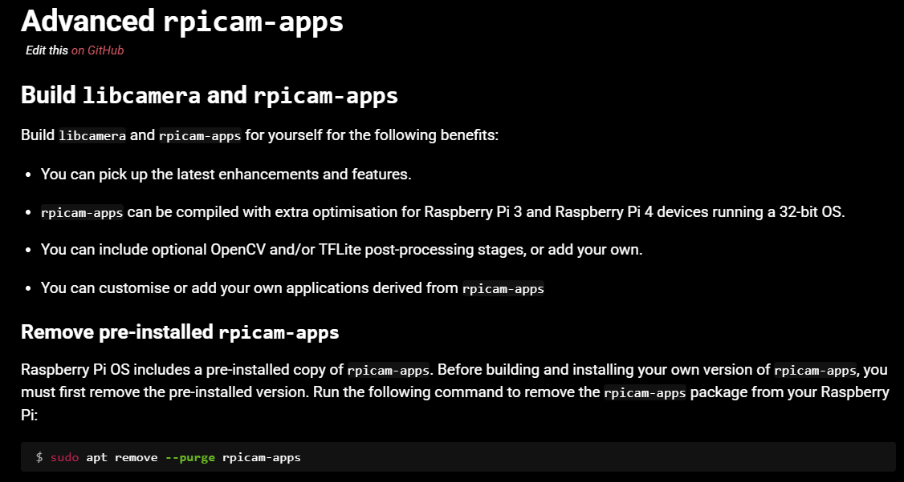
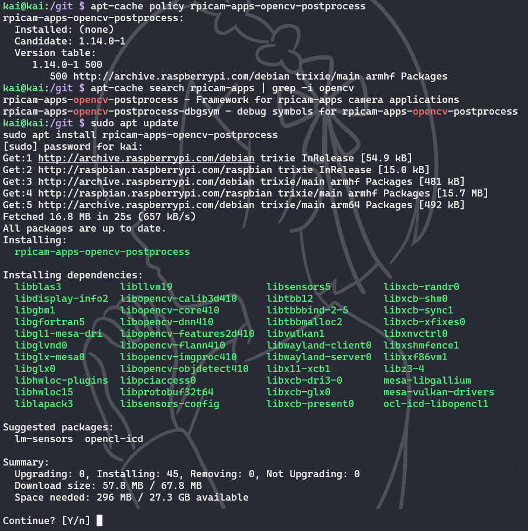
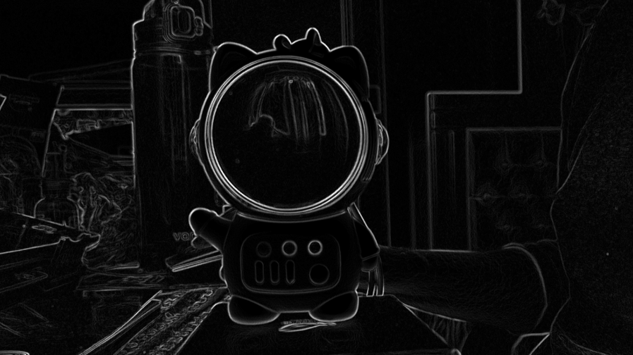

# Fish_Counter

```shell
sudo nmap -sn 192.168.18.1-100
ssh kai@192.168.18.18

sudo apt update
sudo apt upgrade

sudo apt install rpi-connect-lite
systemctl --user start rpi-connect
rpi-connect signin
```
# Commands for camera preview

```shell
rpicam-hello -h

rpicam-hello --version
    rpicam-apps build: v1.14.0 13-10-2026 (09:18:18)
    rpicam-apps capabilites: egl:0 qt:0 drm:1 libav:0
    libcamera build: v0.7.2+rpt20261009

rpicam-hello --list-cameras
    Available cameras
    -----------------
    0 : imx708 [4608x2592 10-bit RGGB] (/base/soc/i2c0mux/i2c@1/imx708@1a)
        Modes: 'SRGGB10_CSI2P' : 1536x864 [120.13 fps - (768, 432)/3072x1728 crop]
                                2304x1296 [56.03 fps - (0, 0)/4608x2592 crop]
                                4608x2592 [14.35 fps - (0, 0)/4608x2592 crop]
```


# Commands for camera detection
-t [ --timeout ] arg (=5sec)          Time for which program runs. If no units are provided default to ms.
-o [ --output ] arg                   Set the output file name
-n [ --nopreview ] [=arg(=1)] (=0)    Do not show a preview window

```shell


sudo rpicam-still --nopreview --timeout 2000 -o test.jpg
```
Run this from WSL Ubuntu (not from the Raspberry Pi SSH session):
```shell
scp kai@192.168.18.18:/git/test.jpg /mnt/c/Users/Mel_C/Data/Documents/git/Mel-Capcha-C/Fish_Counter/test.jpg
/mnt/c/Users/Mel_C/Data/Documents/git/Mel-Capcha-C/Fish_Counter
```

# Post Processing
https://www.raspberrypi.com/documentation/accessories/camera-software.html#post-processing-with-rpicam-apps

To run multiple post-processing stages, create a JSON file that contains multiple stages as top-level keys.
```shell
sudo touch custom_filter.json
sudo nano custom_filter.json
```
For example, to the following configuration runs the Sobel stage, then the negate stage:
```shell
{
    "sobel_cv":
    {
        "ksize": 5
    },
    "negate": {}
}
```

## Debug
```shell
rpicam-hello --post-process-file custom_filter.json
```
When the post-processing command was run the Sobel stage didn't work, the output was only negated. It seems to be related to the following note:

The rpicam-apps supplied with Raspberry Pi OS do not include OpenCV and TensorFlow Lite. As a result, certain post-processing stages that rely on them are disabled. To use these stages, [re-compile rpicam-apps](https://www.raspberrypi.com/documentation/accessories/camera-software.html#build-libcamera-and-rpicam-apps).

Therefore, according to documentation, the pre-installed rpicam-apps should be removed.


Nevertheless, there was no need to do so. GPT recommended to try this method and it worked.


1. Check for a separate OpenCV post-processing package first
Before compiling anything, check whether your Trixie repositories provide a matching package. The Raspberry Pi package archive lists an OpenCV post-processing package for rpicam-apps v1.14.0, so you may not need to build the whole application yourself.

```shell
apt-cache policy rpicam-apps-opencv-postprocess
    rpicam-apps-opencv-postprocess:
    Installed: (none)
    Candidate: 1.14.0-1
    Version table:
        1.14.0-1 500
            500 http://archive.raspberrypi.com/debian trixie/main armhf Packages
```
2. If the package is available, install it
If apt-cache policy shows a candidate version, run:
```shell
sudo apt update
sudo apt install rpicam-apps-opencv-postprocess
```

Now the Sobel filter works :)
```shell
rpicam-hello --rotation 180 --post-process-file custom_filter.json
```

# OpenCV Installation
```shell
sudo apt update
sudo apt install libopencv-dev pkg-config

pkg-config --modversion opencv4
    4.10.0
```
